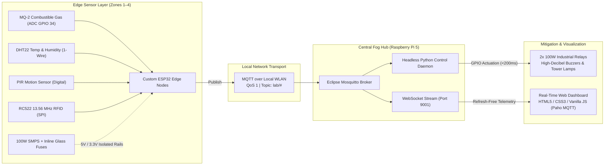

# SmartLab Safety System: IoT Enabled Safety & Accountability

> **A distributed, edge-computing IoT safety and forensic accountability network (Aura x9) engineered to replace isolated legacy laboratory alarms with sub-200ms local mitigation and real-time spatial telemetry.**

---

## 📌 Overview

Modern academic, clinical, and industrial laboratories face critical safety vulnerabilities when relying on standalone, isolated alarm systems or high-latency cloud-dependent IoT frameworks. The **SmartLab Safety System** is a distributed, edge-computing IoT safety network designed to replace legacy isolated alarms. It enforces strict, real-time spatial accountability by merging **13.56 MHz RFID tracking** with multi-variable environmental telemetry across multiple physical zones.

Rather than simply sounding an uncoordinated local buzzer during an anomaly, this system correlates physical hazard telemetry (combustible gas leaks, thermal spikes, unauthorized motion) directly with the real-time spatial presence of laboratory personnel. By routing all telemetry through a localized fog-computing hub over MQTT and WebSockets, the architecture completely eliminates external cloud dependencies and network bottlenecks—transforming passive environmental monitoring into an active, high-speed forensic safety and rescue network.

---

## 🏗️ System Architecture

The network is organized around a decentralized edge-acquisition and centralized local fog-processing topology across four distinct physical zones (`Zones 1–4`):



### 1. Edge Nodes (`src/edge_nodes/`)
Custom-fabricated **ESP32** (dual-core Xtensa LX6) perfboard units deployed across individual physical zones. Each node performs rapid local sensor polling, signal conditioning, threshold filtering, and lightweight MQTT payload packaging:
- **Gas & Smoke Detection (`MQ-2`):** Monitors combustible gases (LPG, propane, smoke) via an SnO2 sensitive layer and micro-machined ceramic heater. Read via the ESP32 analog-to-digital converter (`GPIO 34`) through a protective voltage divider, with a critical danger threshold calibrated at `2000 ppm`.
- **Climate Baseline Monitoring (`DHT22`):** Provides calibrated digital 1-Wire readings for ambient temperature and relative humidity to verify chemical and biological storage stability.
- **Spatial Security & Motion (`PIR`):** Passive Infrared digital motion sensors that detect human movement and trigger unauthorized access protocols during restricted off-hours.
- **Forensic Access & Accountability (`RC522 RFID`):** 13.56 MHz RFID readers interfacing with the ESP32 via dedicated hardware SPI pins (`MOSI`, `MISO`, `SCK`) on `3.3V` logic. Captures 8- or 16-digit personnel badge IDs in real time to correlate specific individuals with active hazard zones.

### 2. Power & Protection
- **Centralized 100W SMPS:** Power distribution is driven by a central 100W Switch Mode Power Supply delivering regulated DC power via heavy-duty 2-pin screw terminal blocks for mechanical resilience.
- **Localized Short-Circuit Protection:** Every edge node is wired in series with an **inline panel-mount glass fuse**, ensuring any electrical fault or short-circuit is immediately isolated to that specific node without compromising the rest of the network.
- **Custom PCB Floor-Planning (Thermal & RF Isolation):** Assembled on custom perfboards with central `5V` and `GND` copper buses and housed in custom sunboard enclosures:
  - **Thermal Zones:** The heat-generating `MQ-2` sensor (powered on a dedicated high-current `5V` rail) is physically mounted on the opposite extremity of the board from the temperature-sensitive `DHT22` probe to prevent localized heat dissipation from skewing baseline climate readings.
  - **RF & EMI Isolation Zones:** Analog signal lines from the `MQ-2` are routed away from the high-frequency digital switching paths of the SPI bus and the ESP32 Wi-Fi antenna to minimize electromagnetic interference (EMI), prevent signal attenuation, and stabilize ADC conversions.

### 3. Central Hub (`src/pi_broker/`)
A **Raspberry Pi 5** (64-bit quad-core ARM Cortex-A76 running Raspberry Pi OS) acts as the local fog-computing hub, completely bypassing third-party cloud latency and internet outage vulnerabilities:
- **Eclipse Mosquitto MQTT Broker:** Routes machine-to-machine (M2M) telemetry across the local wireless LAN using a strict hierarchical topic structure (e.g., `lab/node1/temperature`, `lab/node2/gas`, `lab/node3/access`) and wildcard subscriptions (`lab/#`). Each ESP32 node is assigned a unique MQTT Client ID at boot to prevent network loop crashes and connection drops.
- **Headless Python Control Daemon:** A decoupled background service that continuously evaluates incoming telemetry against safety thresholds. Upon detecting a breach, it immediately actuates Raspberry Pi GPIO pins to latch **two 100W industrial relays**, triggering high-decibel sirens/buzzers, LED status tower lamps, and access locks.

### 4. Real-Time Web Dashboard (`src/web_dashboard/`)
An asynchronous, dark-mode **HTML5 / CSS3 / Vanilla JavaScript** human-machine interface (HMI) served locally and connected directly to the Mosquitto broker via the **Paho MQTT JavaScript library**:
- **WebSockets Integration (`Port 9001`):** Maintains a persistent, full-duplex WebSocket connection subscribed to `lab/#`, dynamically generating and updating zonal status cards without page reloads.
- **Dynamic Hazard Visualization:** When a node reports a threshold breach (e.g., `MQ-2 >= 2000`), the UI triggers dynamic CSS `"danger"` pulse-animations on the affected zone card while displaying the live RFID badge IDs of exposed personnel for targeted emergency response.

---

## ⚡ Performance Metrics

By keeping telemetry routing and actuation logic strictly within the local area network (LAN), the SmartLab Safety System achieves deterministic, near-zero-latency performance compared to legacy polling and cloud-dependent architectures:

- **~11–15 ms Network Latency:** Utilizing **MQTT over TCP (QoS 1)** guarantees message delivery ("at least once") with a mean network transport latency of **~11–15 ms** and very low jitter.
- **Sub-200 ms Total System Response Time:** End-to-end execution—from physical hazard detection at the ESP32 edge node to automated hardware mitigation (actuating the 100W industrial relays for high-decibel buzzers and bright tower lamps) and WebSocket UI rendering—completes in **under 200 milliseconds** (frequently achieving **sub-100 ms** in local gas-leak actuation benchmarks).

### Protocol & System Latency Comparison

| Protocol / System Architecture | Data Payload | Mean Latency | Jitter / Stability | Suitability for Lab Safety |
| :--- | :--- | :--- | :--- | :--- |
| **HTTP (Client-Server Polling)** | Moderate | `> 500 ms` | High | Poor (High overhead & server bottlenecks) |
| **Cloud IoT Systems (ThingSpeak / Blynk)** | Moderate | `~2000 – 2370 ms` | High | Poor (Vulnerable to WAN outages) |
| **WebSocket (Persistent UI Stream)** | Small to Large | `~41.5 ms` | Moderate | Moderate (Ideal for real-time visualization) |
| **MQTT over TCP (QoS 0)** | Small | `~8 – 10 ms` | Low | Good (Unreliable fire-and-forget delivery) |
| **MQTT over TCP (QoS 1 — SmartLab)** | **Small** | **`~11 – 15 ms`** | **Very Low** | **Optimal (Guaranteed delivery & `< 200 ms` total actuation)** |

---

## 📂 Repository Structure

```text
SmartLab-Safety-System/
├── docs/                        # Architectural diagrams, PCB schematics, and project documentation
├── src/
│   ├── edge_nodes/              # ESP32 C++ firmware (sensor polling, SPI RFID, MQTT client logic)
│   ├── pi_broker/               # Raspberry Pi 5 Mosquitto configs & headless Python relay daemon
│   └── web_dashboard/           # Real-time HTML/CSS/JS dashboard (WebSockets Port 9001 & Paho MQTT)
├── Aura-x9_Conference_Paper-1.pdf
├── FY_Merged_Final (1).pdf
├── .gitignore
└── README.md
```

---

## 🚧 Future Code Uploads

> [!NOTE]
> **Hardware Extraction in Progress:** The active production codebase—including the **headless Python broker/GPIO control scripts** (`src/pi_broker/`), the **ESP32 C++ Arduino firmware** (`src/edge_nodes/`), and the **WebSocket dashboard source files** (`src/web_dashboard/`)—currently resides on the physical Raspberry Pi 5 hub and edge microcontrollers. These scripts and firmware packages will be extracted from the edge devices and uploaded to their respective directories soon.
